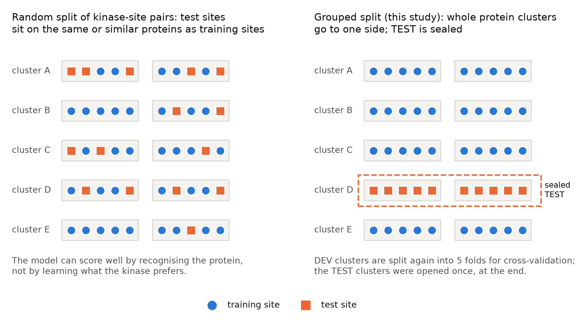
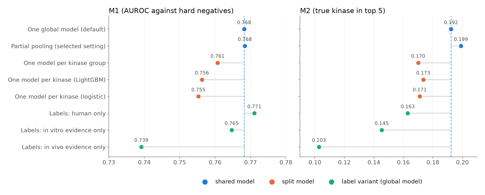
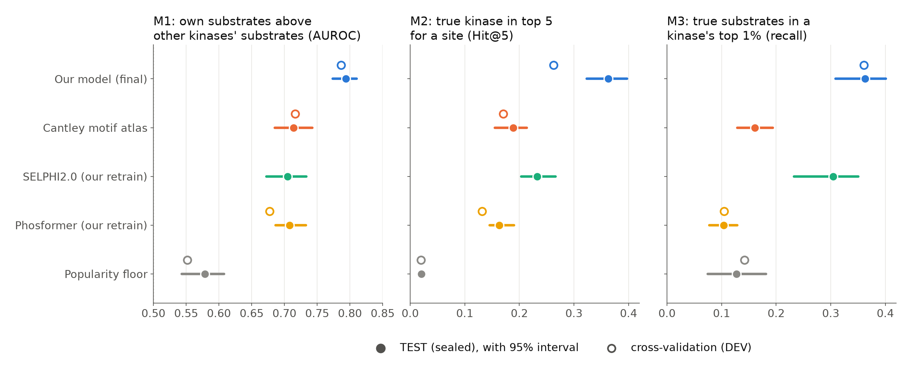

# Which kinase phosphorylates which site? A fair test, a modest predictor, and what AI agents did when they ran the study

*Research briefing for a broad scientific audience. Authors: [authors to be added by the publishing researcher]. Date: 2026-10-28.*

> **AI-agent exercise.** This work was produced as an exercise in testing whether AI agents can run a bioinformatics research project. A lead AI agent (the 'PI', Claude Opus 5.5) directed sub-agents (Claude Opus 5.5 and Sonnet 5.5) under a human-written brief. The human researcher supplied the brief, the data and PhosphoSitePlus access; they did not write the code, run the analyses, or write the text. All results should be checked before use.

## In brief

- **We built a stricter test for kinase–substrate predictors.** Similar proteins never appear on both sides of the split, the negative examples are hard ones, every kinase counts equally, and the final test set was sealed and opened once.
- **On that test, our predictor beat the three comparison methods on all three main metrics.** It beat the Cantley motif atlas and our own retrained versions of Phosformer and SELPHI2.0 on all nine pre-registered tests. Its main score (M1) was 0.794 on the sealed test, against 0.714 for the atlas. One of the nine margins, against SELPHI2.0, was small. Part of the margin over the atlas reflects a weak test draw for it (the cross-validation margin was +0.063), and the test rise in the site-level score M2 reflects which kinases were tested, not an improvement.
- **The predictor works for serine/threonine kinases, not for tyrosine kinases.** Ser/Thr kinases scored 0.841. Tyr kinases scored 0.595, barely above a simple rule that favours well-studied sites (0.585). We do not trust any Tyr result.
- **The outputs are shortlists, not answers.** No site reached an assignment probability (a calibrated probability that the top-ranked kinase is right; Section 5) of 0.8. For a known site, the top-ranked kinase was a known kinase of that site 35% of the time.
- **The agents worked fast and checked each other, but made avoidable mistakes.** Independent agent audits caught real errors, most of them before the test set was opened. The team froze the model 5.3 h before its own planned gate, and the single test run finished 11.6 h into the 24-hour budget, 4.4 h before that gate. Several rules that existed only as text were not followed.

> **Glossary (terms in the order they first appear)**
> - **Kinase:** an enzyme that adds a phosphate group to a protein. Humans have about 500 protein kinases.
> - **Phosphosite (site):** one serine (S), threonine (T) or tyrosine (Y) residue that carries a phosphate. **Substrate:** the protein (or site) that a kinase phosphorylates.
> - **Ser/Thr (S/T) and Tyr (Y) kinases:** most kinases act on S/T; a separate group acts on Y; a few act on both ("dual-specificity").
> - **Pre-registered:** fixed in writing before the data that test it were seen.
> - **PhosphoSitePlus (PSP):** a curated database of kinase–site pairs taken from published papers. It is the source of our labels.
> - **Leakage:** information about the test answers reaching the model during training, for example through the same protein appearing on both sides of a split.
> - **Positive–unlabelled (PU) data:** we know some true pairs, but a missing pair may be either false or simply unstudied. There are no confirmed negatives.
> - **Homology cluster:** a group of proteins with similar sequences. **Paralogs:** related kinases within one species, which often share substrates.
> - **Hard negative:** a site with a curated label to another kinase outside the kinase's paralog group. It is harder to reject than a random site.
> - **Cross-validation (CV):** training on part of the development data and scoring the rest, in rotation (here five "folds"). **DEV:** the development data. **TEST:** the sealed data scored once at the end.
> - **AUROC:** the chance that a randomly chosen true example is ranked above a randomly chosen negative one. 0.5 is a coin flip; 1 is perfect.
> - **Macro average:** compute a score for each kinase, then average, so that every kinase counts equally.
> - **Popularity floor:** a control that ranks sites only by how often they have been reported, the same way for every kinase. Beating it shows that a model learned something about the kinase.
> - **Canary kinase:** a fake kinase given random "substrates". Any honest pipeline should score it near 0.5.
> - **Kinase group:** a branch of the standard kinase family tree (Manning et al. 2002); groups contain families.
> - **LightGBM:** a fast method that builds many small decision trees. **Protein language model (ESM-2):** a neural network trained on millions of protein sequences; it turns each residue into a vector of numbers.
> - **Distillation:** training one model to reproduce the outputs of another source, here the Cantley atlas, before training on labels.
> - **Late fusion:** averaging the outputs of two separately trained models.
> - **Calibration:** adjusting scores so that "0.6" means right about 60% of the time, measured on sites that have a curated kinase.
> - **Expected calibration error (ECE):** the average gap between claimed and observed precision across probability bins, weighted by the number of sites; 0 is perfect.
> - **95% interval (CI):** a range built so that, over many repeats of the study, 95% of such ranges would contain the true value. Here it comes from a **bootstrap**: protein clusters are resampled many times, with the set of kinases held fixed.
> - **Holm correction:** a rule that adjusts p-values when several tests are run together, so that the chance of any false "win" among them stays below 5%.
> - **Ablation:** removing one part of a model to see how much it contributed.
> - **FREEZE and ledger:** a file that fixes every prediction file by checksum before the test, and a log of the start and end of the test run. The test code refuses a second run unless an explicit, logged override is used.

---

## 1. The question and why it is hard

For about 95% of known human phosphosites, no kinase has been assigned. In PSP, the 20 most-studied kinases account for about half of all human kinase–substrate annotations, and 146 of 421 annotated kinases have fewer than five.

We asked: given a human kinase and a human S/T/Y site, how likely is it that the kinase phosphorylates that site directly? The predictor scores 503 kinases against every observed site of the matching residue type. The answers can be read in two directions: which sites does a kinase phosphorylate, and which kinases act on a site? Such predictions help to interpret phosphoproteomics data, to choose experiments and to build substrate lists for kinase-activity tools.

Many published predictors report high accuracy, but most evaluations flatter them, for three reasons.

1. **Shared proteins leak between training and test.** In a random split, a test site often sits on the same protein as a training site, or on a close homolog: 68% of known pairs have another labelled site on the same protein. A model can then score well by recognising the protein. On Phosformer's released splits, 51% of the test-positive peptides also occur as training positives under another kinase.
2. **Easy negatives.** Random sites are easy to reject. Sites labelled to other kinases are harder, but many of them are substrates of the kinase's own paralogs, so they are not true negatives.
3. **A few kinases dominate.** Pooled over all pairs, a score mostly measures the 20 best-studied kinases. Labels are also biased toward well-studied proteins, so a model can learn "popularity" instead of kinase specificity.

Published numbers show the size of the effect. SELPHI2.0 reports a cross-validated AUC of 0.97, which falls to 0.75–0.83 on external data (Maier et al. 2025). LinkPhinder drops from 0.97 on random splits to 0.53 on independent data (Nováček et al. 2020). A split that respects the kinase family tree gave 0.755 for S/T sites for the sequence-only KolossuS model (Jha et al. 2025).

**Figure 1. The study in six steps.** Known kinase–site pairs from PhosphoSitePlus (1) are split into a development set and a sealed test set, so that similar proteins stay on one side (2). For every kinase–site pair, several kinds of evidence are collected (3) and fed to two models (4), whose outputs are combined by a weighted average and turned into a probability (5). The outputs are ranked lists for 503 kinases and 350,736 observed sites (6). All choices were made by cross-validation on the development set; the frozen model was scored once on the sealed test set and checked by an independent agent.

## 2. Step 1: building a fair test

### Labels: what counts as a known pair

*Problem:* there is no complete list of kinase–substrate pairs. *Choice:* we took pairs from PSP (release 2025-05-19), which curates them from the literature. *Why:* it is the largest curated resource, and the comparison methods also use it. *Cost:* PSP reflects what has been studied, and some of its entries may be indirect effects rather than direct phosphorylation.

Two further choices were tested on CV (Section 5). *Species pooling:* we added mouse and rat pairs when the 15 residues around the site are identical in human, giving 18,638 pairs for 401 kinases. *Evidence type:* PSP marks whether a pair was seen in a test tube ("in vitro"), in cells or tissue ("in vivo"), or both; in-vivo-only pairs are more likely to be indirect. The default labels keep all evidence types.

### No true negatives

*Problem:* nobody publishes "kinase K does not phosphorylate site S". *Choice:* we treated the data as positive–unlabelled (Elkan and Noto 2008). Unlabelled sites are used as negatives, and every probability is read as "the chance that this pair is a curated PSP positive". *Why:* this is the honest reading of the data. *Cost:* if curated pairs are correct, the precisions we report underestimate true precision, because some unlabelled pairs are real. Some curated pairs are indirect, though, so even this is not guaranteed. We cannot measure the false-positive rate on unlabelled sites.

### Which negatives

*Problem:* random sites make the task too easy, and sites of other kinases include substrates of the kinase's relatives. *Choice:* two negative sets, defined in advance. The primary set, "E-hard", holds sites with a PSP label to a kinase *outside* the kinase and its paralogs (at least 60% kinase-domain identity, or the same subfamily). "E-all" holds every other observed site of the right residue type, minus known substrates and near-identical sequences. *Why:* a design reviewer found that more than half of the hard negatives for the SRC family were substrates of SRC paralogs; without the mask, correct predictions would be punished. *Cost:* E-hard tests specificity among real substrates, not the full search problem; E-all covers that.

Positives and negatives were also restricted to sites seen by mass spectrometry: 18% of human positives lacked such evidence, against 0.4% of unlabelled sites, so "observed or not" would otherwise give the label away.

### Preventing leakage: grouping by homology

*Problem:* random splits put sites from the same or similar proteins on both sides (Figure 2). *Choice:* we grouped proteins into 11,609 homology clusters (mmseqs2; at least 40% identity over at least 50% of the length; Steinegger and Söding 2017) and split whole clusters. Grouping by protein was a request of the human brief; we used clusters instead of single proteins, because similar proteins would otherwise carry each other's labels across the split. *Why:* the model must then predict sites on proteins it has never seen. *Cost:* the test is harder, and its numbers are not comparable with published random-split numbers.

Every feature computed from labels, such as "how similar is this site to the kinase's known substrates", was "cross-fitted": recomputed for each site without its own protein cluster. One piece of code does this for all such features and stops with an error if a label from the query protein would be used. Without cross-fitting, one such feature reached AUROC 0.93–1.00; with it, 0.59–0.76.

**Figure 2. Why random splits overestimate accuracy.** Each grey bar is a protein with five sites; two homologous proteins form a cluster. Left: when kinase–site pairs are split at random, test sites (orange squares) sit on proteins whose other sites, or whose homologs, are in training (blue circles), so a model can succeed by recognising the protein. Right: in this study whole homology clusters went to one side. About 20% of clusters (here 1 of 5) were sealed as TEST and opened once; the rest (DEV) were split again into five folds for cross-validation.

### The sealed test set

*Problem:* a test that informs choices stops being a test. *Choice:* 2,353 of the 11,609 clusters (20.3%; 3,957 proteins; 2,205 test positives) were sealed as TEST. Their labels were stored with a checksum. A software test checked that only the test code read them; after the run, the independent auditor read them read-only to reproduce the results. Before the test, a FREEZE file fixed every prediction file and the nine planned comparisons. A ledger logged the start and end of the test run, and the test code refuses a second run without an explicit override. *Why:* one look, fixed in advance, makes the test numbers credible. *Cost:* anything learned afterwards cannot be confirmed on this set (Section 8).

### Three difficulty tiers and the controls

- **T1, seen kinase, unseen proteins:** the main tier, on CV and TEST.
- **T2, unseen kinase family, seen proteins:** whole kinase families removed from training (CV only).
- **T3, unseen kinase family and unseen proteins:** the hardest case, on TEST.

Kinase families for T2 and T3 were 120 clusters of kinases with similar domains or the same family.

Controls ran through the same pipeline as the real models: the popularity floor, B0-prior (a control that ranks kinases only by their number of known substrates), twelve *negative canaries* (fake kinases with random real substrates, required to score at most 0.57) and one *positive canary* (a planted motif, required to score at least 0.90). The final model passed with the folds pooled (0.539 and 1.000), but two of five single folds exceeded 0.57, so this gate is weaker than intended.

## 3. Step 2: the metrics, one by one

All metrics are macro averages, so that a kinase with 5 known substrates counts as much as one with 600. *Why:* pooled metrics would mostly measure the best-studied kinases. *Cost:* averages over kinases with few test substrates are noisy. Figure 3 shows a toy example for each metric.

- **M1 (primary): can the kinase tell its own substrates from other kinases' substrates?** For each kinase, the AUROC of its true substrates against its E-hard negatives. In the toy list of 4 true substrates and 8 hard negatives, AUROC 0.88 means that a random true substrate is ranked above a random hard negative 88% of the time. M1 rewards kinase specificity and is less sensitive to popularity.
- **M2 (Hit@5): for a known site, is its true kinase among the top five?** For each site, the few hundred candidate kinases of the matching residue type are ranked, after removing other true kinases of that site and unlabelled paralogs of the true kinase, so that a correct alternative is not penalised. M2 is the share of a kinase's sites where it lands in the top five, averaged over kinases. This is the "who did it?" question.
- **M3 (top-1% recall): does the kinase's top 1% contain its true substrates?** All candidate sites of a kinase (about 60,000 for a typical S/T kinase) are ranked, and we count how many of its true substrates fall in the top 1%. This is closest to "give me a short list to test".
- **M4: M1 over a broader set of kinases.** On TEST, M1 uses the 119 kinases with at least 3 test substrates on at least 2 clusters; M4 uses all 256 kinases with at least one, so it includes understudied kinases. On CV, the evaluated set is the 203 kinases with at least 5 development substrates on at least 2 clusters.

A useful model must also beat the popularity floor. On TEST, the floor reached M1 0.578, well above the coin-flip 0.5, which shows how much popularity alone carries.

**Figure 3. What each metric asks, with toy examples.** M1: one kinase's candidate sites ranked from best to worst; blue are its true substrates, grey are hard negatives (sites labelled to unrelated kinases); AUROC is the chance that a true substrate beats a hard negative (0.88 here). M2: for each known site, the candidate kinases are ranked; a "hit" means that the true kinase (orange) is in the top five. M3: for one kinase, all candidate sites are ranked; recall is the share of its true substrates in the top 1% (bar not to scale). All three are computed per kinase and averaged with equal weight.

The nine primary comparisons (our model against each of three baselines on M1, M2 and M3) were fixed before the test. "Beats" required a Holm-corrected p-value below 0.05 and a 95% interval for the difference that excludes zero.

## 4. Step 3: the comparison methods, retrained fairly

*Problem:* published accuracy figures come from different splits, labels and negatives. *Choice:* the brief asked for baselines retrained on our splits, labels and negatives. *Why:* only then do differences reflect the methods. *Cost:* we may train other people's methods less well than their authors would.

- **Cantley motif atlas (B1).** The Cantley lab measured each kinase's sequence preference with peptide arrays, for 303 S/T kinases (Johnson et al. 2023) and 93 Tyr kinases (Yaron-Barir et al. 2024). The atlas uses no curated pairs, so it needs no retraining. We used, for each metric, the stronger of two scoring variants. Ten dual-specificity kinases with only one matrix were left out of the TEST comparisons, which can only help the atlas.
- **Phosformer (B3; Zhou et al. 2023).** A transformer that reads the kinase domain and an 11-residue peptide, reimplemented and retrained. *Fidelity check:* our code, trained on Phosformer's own published split, gave AUROC 0.888 on its test split, against 0.885 in the paper. This rules out a broken pipeline, but not under-training on our folds (one seed, a fixed 1:16 ratio of negatives to positives, at most three fine-tuning epochs).
- **SELPHI2.0 (B4; Maier et al. 2025).** A random forest that combines motif, co-expression and co-regulation features, ported with 10 instead of 100 bags. 66.6% of TEST pairs lacked its site features and used default values; a CV check put the cost at about 0.013 M1.

On CV, both retrained learned methods scored below the label-free atlas on M1 (Phosformer 0.677, SELPHI2.0 0.708 on the 34% of pairs it covers, against 0.717 and 0.728 for the atlas). SELPHI2.0's published 0.97 probably reflects random-pair negatives: on our cluster split, the same "positives versus random pairs" measure still gave 0.947. The released Phosformer weights scored 0.796 on the 2% of pairs they could score, but they were trained on PSP pairs that include our test positives, so this is only a contaminated contrast.

## 5. Step 4: our models

### What information was used

For every kinase–site pair, we collected seven kinds of evidence: the **sequence motif** (Cantley scores, including versions that assume a nearby site is already phosphorylated, "primed"); **protein language model** vectors for the site and the kinase domain (ESM-2; Lin et al. 2023); **structure** around the site from AlphaFold models; **interactions** in systematic screens such as BioPlex, HuRI and OpenCell; shared **localisation**; **co-expression** in tissues and co-essentiality in cancer cell lines; and **phosphoproteomics** (whether the site rises and falls with the kinase's known substrates, how it responds to 692 inhibitor treatments given the kinases each drug binds, and the kinase's own state in tumours). Sources that already contain PSP labels were excluded after measurement: STRING (34% of PSP pairs have a STRING score, against about 4% of controls) and the iKiP-DB combined tables (61% of PSP pairs).

### The two models

*Problem:* the evidence is of two kinds: many weak context features, and sequence features that can be shared across kinases. *Choice:* two models.

- **R2, a LightGBM pair model.** One model for all kinases, with 172 features per (kinase, site) row. Kinase descriptors (family, an ESM-2 summary of the kinase domain, a summary of its Cantley profile) let understudied kinases share trees with well-studied ones, and well-studied kinases were down-weighted. Each kinase had 50 negatives per positive, half of them hard. Five copies with different random seeds were averaged.
- **R3, a neural model distilled from the Cantley atlas.** It encodes each site window and each kinase as vectors and scores their match. It was first trained to reproduce the label-free Cantley scores, then on the PSP labels. Distillation raised its M1 by +0.019 [0.010, 0.033] (measured before the A24 metric fix, Section 8). A design reviewer in the role of an external PI proposed this idea; it follows Phosformer-ST (Zhou et al. 2024) and KolossuS (Jha et al. 2025).

*Why two:* R2 uses many kinds of evidence, but its scores are only partly comparable across kinases; R3's are comparable by construction, which the site-centric M2 needs. *Cost:* this rationale was not tested part by part.

### Late fusion

Each model's scores were standardised (rescaled to mean 0 and spread 1) and combined as 0.6 × R2 + 0.4 × R3, with the weight chosen on CV M1. A check that re-chose the weight inside each fold picked the same weight every time. For ranking kinases at a site (M2), the two scores are weighted equally (0.5 and 0.5, chosen on CV M2). The alternative, feeding R3's output into R2 as a feature ("stacking"), would have needed 36 neural trainings instead of 6.

### Calibration: the assignment probability

For each site, the model's scores were turned into an "assignment probability" for the top kinase. Each kinase's scores were first put on a common scale (Platt 1999 [verify]). The probability was then shared across all candidate kinases so that it sums to one, and the top value was corrected with a monotone map fitted on labelled sites, separately for S/T and Tyr (isotonic regression; Zadrozny and Elkan 2002). The number means: *if this site is a substrate of one of the modelled kinases, how likely is it that the top kinase is a curated true kinase?* It says nothing about whether an unlabelled site is a substrate at all. The separate S/T and Tyr maps were added after an audit found an earlier version overconfident (Section 8).

### Training regimes and label variants

The brief asked whether one model for all kinases, one per kinase, or something in between works best. We tested each option on CV with R2 (Figure 4).

- **One global model won.** It beat per-kinase models (M1 0.768 against 0.756 and 0.755) and per-group models (0.761), even on the 78 data-rich kinases with at least 20 labels in every fold (0.805 against 0.779). Partial pooling, which lets each kinase deviate from the global model by a tunable amount, chose a setting that matches the global model on M1.
- **Pooling mouse and rat labels helped M2** (human-only labels lowered M2 by 0.029, with no M1 gain).
- **In-vivo-only labels were worse on every metric**, but that set is about three times smaller than the in-vitro set, so the comparison mainly measures label count.
- **Extra curated labels from other databases** gained +0.006 M1 with one seed and +0.001 over three seeds, and were not adopted.

*Why this is plausible:* most kinases have few labels, and kinases with similar domains have similar preferences, so sharing evidence is worth more than the flexibility of separate models. Whether understudied kinases gain through the descriptors was not tested directly.

**Figure 4. One shared model beat split models.** Cross-validation results for different ways of training the LightGBM model (one seed each; dashed line: the default global model). Models split by kinase or by kinase group (orange) lost on both M1 and M2; their M2 uses scores mapped onto the global model's scale. Partial pooling (blue) chose a setting that matches the global model on M1. Among label variants (green), human-only labels matched M1 but lowered M2, and in-vivo-only labels were worst, partly because that set is three times smaller than the in-vitro set. Seed-to-seed variation in M1 is about 0.003.

## 6. Step 5: results

### Cross-validation, then the single test

On 5-fold CV over 203 kinases, the fused model led on every metric: M1 0.786, M2 0.263, M3 0.361 (Figure 5). Each component alone was weaker (R2 0.776, R3 0.754). Against the Cantley atlas on the same pairs, the gains were +0.063 [0.048, 0.074] on M1, +0.105 on M2 and +0.227 on M3.

The single TEST run scored 12 frozen configurations over 25.9 million pairs. The final model reached M1 0.794 [0.774, 0.811], M2 0.363 [0.324, 0.397] and M3 0.363 [0.309, 0.401]. All nine pre-registered tests met the "beats" rule. Eight reached the smallest p-value that 10,000 resamples can show (0.0002: no resample favoured the baseline), so their true p-values are smaller; after Holm correction they are 0.0018. Against Cantley, the M1 gain was +0.075 [0.046, 0.099], and the final model was better on 97 of the 116 kinases that both methods score. The weakest test was M3 against SELPHI2.0: +0.059 [0.010, 0.120], with 52 kinases better, 27 worse and 40 tied. An independent audit agent reproduced every TEST number.

**Figure 5. Cross-validation and sealed-test results against the comparison methods.** Filled dots: TEST values with 95% intervals from a bootstrap over protein clusters. Open dots: cross-validation values on the development set. The SELPHI2.0 cross-validation values and the Cantley M3 value are not plotted, because they were computed on a different set of pairs. For Cantley, the stronger of its two scoring variants is shown per metric. Phosformer and SELPHI2.0 are our retrains, not the published systems. The M2 rise from CV to TEST reflects which kinases are in the test set, not an improvement (see text).

Four caveats limit how far these numbers can be read.

- **No drop from CV to TEST on M1.** On the 117 kinases in both sets, CV M1 was 0.792 and TEST M1 0.793, so the many CV comparisons did not inflate M1 much.
- **The M2 rise is composition, not improvement.** M2 rises with the number of known substrates, and the TEST kinases are better studied. On the same 117 kinases, CV M2 was 0.348 against 0.363 on TEST, and a label-free control moved the same way.
- **Part of the margin over Cantley is a weak draw for Cantley.** On the 115 kinases scored in both sets, Cantley fell from 0.741 on CV to 0.717 on TEST, almost entirely on Tyr kinases, while our model was flat. The CV margin (+0.063) is the more conservative estimate.
- **The baselines are our retrains.** The claims apply to our versions under this benchmark, not to the published tools as distributed.

### Ablations: which evidence mattered

Adding feature groups to R2 one at a time (CV) showed three things. Site structure and ESM-2 features nearly doubled M3 (0.125 to 0.236). Kinase descriptors added +0.014 M1 and raised M2. The phosphoproteomics features together added about +0.002 M1, inside the noise: a negative result for evidence that the brief emphasised. Removing the 18 studies that PSP cites as label sources left M1 unchanged (0.773), so there was no sign of circularity.

### Per kinase, understudied kinases and popularity

M1 held up across label counts (Figure 6A): kinases with 5–19 training labels scored 0.759, and those with 100 or more 0.795. M4 was 0.807 for 16 kinases with no development labels. Site-centric ranking (M2) did not hold up: on CV, Hit@5 for kinases with 5–19 labels was 0.142, below Cantley's 0.162, against 0.621 at 100 or more labels. When asked "which kinase?", the model favours well-studied kinases. On hub sites (labelled to at least five unrelated kinases), the model scored 0.863, but the popularity floor alone reached 0.788, so gains there are mostly popularity. On pairs added to PSP since 2021, the margin over Cantley was smaller (+0.056) but positive. Strata have no confidence intervals.

### Unseen kinase families

With a kinase's whole family removed from training, the fusion reached M1 0.749 on CV (T2) and 0.752 on TEST (T3). This is above Cantley's overall TEST value (0.714; the atlas uses no labels, so holding out families does not change it), but no paired T3 test was pre-registered, so the comparison is descriptive. T2 is not fully "unseen", because the label-free Cantley scores of held-out kinases enter R3's pre-training.

### Tyrosine kinases: the weak spot

On TEST, Tyr kinases reached M1 0.595, barely above their popularity floor of 0.585 (Figure 6B). The model beat its own floor on only 10 of 23 Tyr kinases, against 91 of 94 S/T kinases. Cantley was at chance (0.496), and our Phosformer and SELPHI2.0 retrains were below the floor (0.534 and 0.575). Tyr kinases also fell from CV to TEST on the same kinases (0.667 to 0.595), and scored 0.531 on unseen families. On CV, promiscuous tyrosine "hub" sites and weak atlas matrices were linked to the atlas's Tyr gap, but neither hub sites nor evidence type explained our model's gap, and we have no tested explanation. The audit rated the Tyr result as not trustworthy as a claim of skill.

**Figure 6. Results per kinase, and Ser/Thr against Tyr kinases.** (A) Each point is one of the 119 TEST kinases: its M1 on the sealed test against the number of its known substrates in training (log scale; kinases with 0 or 1 label are drawn at "≤1"). Filled points beat that kinase's own popularity floor; hollow points do not. Most Ser/Thr kinases (dark grey circles) score well regardless of label count; Tyr kinases (purple triangles) are spread widely, mostly between 0.4 and 0.7, and 13 of 23 do not beat their floor. (B) TEST M1 averaged over Ser/Thr kinases (94) and Tyr kinases (23) for each method; colours here denote methods, not residue types. For Tyr kinases, only our model is above the popularity floor (grey), and only by 0.01. Values are descriptive; strata have no confidence intervals.

### Priming kinases

GSK3, CK1, CK2α and PLK1 prefer sites near an already phosphorylated residue ("priming"); this list was fixed in advance. On TEST, primed positives scored 0.897 against 0.704 for the standard Cantley score, which ignores priming. On unprimed positives of the same kinases, the two nearly tied (0.740 against 0.725). On CV, however, the priming-aware Cantley score beat our model on primed sites (0.945 against 0.893). That score was not frozen for TEST, so we cannot claim to beat it (Section 8).

### Calibration

On 1,458 labelled TEST sites, the assignment probability was well calibrated for S/T sites (overall expected calibration error 0.026; Figure 7). The top-ranked kinase was a known kinase for 35.3% of sites. No site reached 0.8. In the tier at 0.5 or higher (345 sites, all S/T), the claimed probability averaged 0.615 and the observed precision was 0.603. No top-ranked Tyr kinase could exceed 0.445, and Tyr sites in the 0.2–0.5 range were mildly overconfident (0.41 claimed, 0.34 observed). These precisions hold for labelled sites and do not transfer to unlabelled ones.

**Figure 7. Calibration of the assignment probability on the sealed test.** Labelled TEST sites were grouped by the probability that the model gave its top kinase (x axis). The y axis shows how often that kinase was a known kinase of the site. Points near the diagonal mean that the probabilities can be taken at face value; marker area shows the number of sites per group. No site reached 0.8 (shaded). These precisions apply to sites that already have a curated kinase. They say nothing about precision on unlabelled sites.

### Downstream use: kinase-activity inference

Predicted substrates are often used to infer which kinases are active in an experiment. In benchmarKIN (Müller-Dott et al. 2025), whose published PSP values we reproduced (0.782 against 0.79 on perturbations), a library from a "clean" model variant was at parity with PSP, not better (top 50 per kinase: −0.013 [−0.043, 0.012] on perturbation experiments; +0.011 [−0.027, 0.046] on tumours). For drugs that the model had not seen, it trailed PSP (−0.050 [−0.096, −0.001]). It was much better than a library built from the Cantley atlas (top 100 per kinase for both: +0.176 [0.091, 0.263] on perturbations). These comparisons were not pre-registered, and their intervals are not corrected for multiple tests.

### Coverage of the proteome, and what coverage does not mean

For release, the frozen configuration was retrained on DEV and TEST labels and scored all 350,736 observed sites against 503 kinases (131 million pairs). 29,886 sites (8.5%) had a top kinase at assignment probability 0.5 or higher; 26,762 of them have no PSP kinase. Coverage is not accuracy: a Cantley-only assignment covered a similar number (30,258), and random scores covered 6. The observed sites are about 19% of all S/T/Y residues; the rest were not scored. The calibrators of this deployment model were fitted on DEV and not re-tested.

A caveat for the released site table: the kinase with the highest `assignment_prob` is not always the kinase with the highest model score. This happens at 25,532 of 350,736 sites (7.3%), and at 19 Tyr sites (INSR/IGF1R paralog pairs) a kinase that is not ranked first has `assignment_prob` 0.55; the 0.445 ceiling applies only to the top kinase. The `prob` and `score_site` columns give the model's own ordering. This was found during release preparation; the files were not changed.

## 7. What did not work

The supplement of the accompanying paper (link to be added; copied to `docs/SUPPLEMENT_failed_approaches.md`) lists about 30 ideas that were not adopted, each judged by a rule written before it was run. The most instructive:

1. **Separate models per kinase or per kinase group.** Both lost to one global model, even for data-rich kinases (M1 −0.012 and −0.007).
2. **A fine-tuned language model scoring kinase and site together.** The full version was too slow (3.6–14.3 GPU-hours per fold to score); a cheaper variant overfitted training proteins and failed its gate (M1 0.725 against a required 0.751).
3. **Phosphoproteomics features.** They passed the leakage checks but added about +0.002 M1; their coverage is sparse and biased toward labelled sites.
4. **Explicit priming features.** They did not improve primed sites (−0.006 against a required +0.02), because the atlas features already contained priming information.
5. **Fixes for Tyr kinases.** Features for SH2 docking, a Tyr-specific fusion weight and a "repair" of weak atlas matrices all failed; 38 Tyr kinases with about 1,150 positives cannot support choosing even one extra parameter.
6. **Defects in our own evaluation, found and fixed.** The first negative canaries could be "detected" from site density alone (AUROC 0.76), and a first coverage metric was vacuous: random scores covered 98.5% of S/T sites.

## 8. The agent-science side

### How the team was organised

The study ran in a 24-hour window (2026-10-26 13:20 to 2026-10-27 13:20 CET) under a human-written brief. A lead agent acted as PI: it wrote the design and its 34 amendments, kept a research log and a lessons file, delegated work, decided on adoptions by rules written in advance, and was the only agent that committed to the version history. Four agents reviewed the literature. Seven agents reviewed the design in a first round (an "external PI" and six specialists), and about 80 of their 84 requested changes were accepted; four reviewed it in a second round, and a third round was skipped. Each implementation package was owned by one agent that wrote only in its own files. Separate agents audited results that they had not produced, recomputing headline numbers from saved predictions with read-only data access. A fresh agent with no prior involvement wrote the final retrospective.

The human wrote the brief, supplied the data, the two baseline papers and PSP access, and resolved two of the data requests that agents logged; ten other requests stayed open. The brief also supplied several central design ideas: grouping by protein, leave-substrate-out against leave-kinase-out tests, the comparison of training regimes, species pooling, in vitro against in vivo labels, and attention to priming kinases.

**What is not known.** No human check of the code or analyses is recorded in the project files. The brief made Claude Opus 5.5 and Sonnet 5.5 available, but which model ran which agent is not recorded. The number of agent sessions, how they were launched, how much context they shared and their token cost are not recorded either. The task briefs given to individual agents were not archived, and the authors of the milestone retrospectives are not recorded.

### Timeline

Design and 11 reviews took the first 1.2 hours (Figure 8). The final model configuration existed at 19:19 (T+6.0 h); of 135 timed CV runs, 62 started at or after 20:00, and the best of them reached M1 0.774, against 0.786. Compute was not the constraint (11.8 hours of serial time for all runs). FREEZE was committed at 00:04 (T+10.7 h), 5.3 h before the planned test gate at 05:20 (T+16 h). The TEST run took place from 00:10 to 00:57, finishing at T+11.6 h, 4.4 h before the gate. The test audit, deployment model, three exploratory experiments and a report draft followed by 03:17; then no file was written for about six hours, until the final retrospective and report review (09:27–09:47).

**Figure 8. Timeline of the 24-hour agent project.** Lanes from top: planning and reports; every timed cross-validation run (dots; the star marks the run that became the final model); independent checks by agents that did not produce the work; the sealed test (FREEZE and the single test run, with the planned gate at T+16 h as a dashed line); and process problems named by the final retrospective. The model stopped improving at T+6 h. FREEZE was committed at T+10.7 h, 5.3 h before its planned gate, and the single test run ended at T+11.6 h.

### What the audits caught

The retrospective judged the independent checks to be the best part of the process. They caught:

- **A metric defect (amendment A24).** Pooling CV predictions across folds distorted per-kinase AUROC; the label-free control scored 0.40 instead of 0.50. Found at T+3.7 h, after 47 runs had been scored; all runs were re-scored.
- **Stale intermediate files.** Label-derived features for two folds had been built from an outdated canary table.
- **An overconfident tier.** In the first assignment probability, sites claimed at 0.8 or above (claimed 0.87) were right 54% of the time, and 0 of 41 Tyr sites were right. Separate S/T and Tyr recalibration removed the tier.
- **A bypassable test guard.** A code review of the test harness found that the single-run guard could be bypassed and that a crash would leave no trace; both were fixed before the test.
- **Two "promising" post-test results downgraded.** The post-test audit found that one M2 gain existed only for a variant added after a first result was seen, and that a label-free "priming site present" flag reproduced the other gain.
- **A report review** found 7 factual errors and 6 overstatements; no number behind a scientific claim was wrong.

### What went wrong

- **The sealed test was spent early.** FREEZE was committed 5.3 h before its planned gate. The only reason recorded is that nothing else had beaten the noise floor on CV. The retrospective calls this contrary to the brief, which asked for the best outcome rather than the fastest completion. No second sealed set had been reserved, so the three experiments that followed on known weaknesses could only be exploratory.
- **The protocol was amended while results arrived.** 12 of 34 amendments were made in the last 8.6 hours before and around the freeze, six of them within 40 minutes. Most strengthened baselines or fixed errors for all methods. One (A31a) changed the score used for M2 late, in the favourable direction, after both values had been seen: the raw equal-weight score gave 0.263, the calibrated probability 0.205.
- **A known stronger comparator was left out.** The priming-aware Cantley score was known to beat the model on primed sites about three hours before the freeze, but it was not frozen.
- **A required experiment was scheduled late.** The training-regime comparison was delegated at T+6.6 h, used 38% of CV compute and closed one minute before the freeze.
- **Memory and status records.** At least two jobs ran out of memory, because memory was budgeted against the machine instead of the job's limit; the second came after a rule against it. The delegation status table was never kept current, and the research log carried 11 "in progress" markers, 8 of them for finished work.
- **The PI's blind spots.** The retrospective concluded that the PI optimised for finishing rather than for the result: early milestones became idle time. It reviewed the test harness, the irreversible step, late, and wrote some rules only after the behaviour they were meant to prevent; the rule against changes after the freeze was written one minute after the freeze.

### What the fresh-agent retrospective concluded

Its main finding is that rules built into code changed behaviour (the cross-fitting code that raises an error, the canary gate, the checksums in FREEZE, the standing auditor), whereas rules kept only as text, such as keeping status tables current and budgeting memory, were often ignored. It also credited the project with honouring pre-registered gates when they failed: six negative results were accepted without re-arguing them.

### What we would do differently

1. Reserve two sealed test sets, and make the test code refuse to run before its scheduled time.
2. Turn the brief's requests into a checklist with owners in the first 30 minutes, and run all controls through the real evaluation code before the first model run.
3. Freeze every comparator that beats the model on any pre-registered stratum, and review the irreversible code path first.
4. Spend time saved by early milestones on the known weaknesses while results can still be adopted.

## 9. Credit: ideas from the literature and how we used them

| Idea or resource | Source | How it was used in the final method |
|---|---|---|
| Curated kinase–substrate pairs | PhosphoSitePlus (Hornbeck et al. 2015) | Labels (release 2025-05-19); no data are redistributed |
| Ser/Thr and Tyr motif atlases | Johnson et al. 2023; Yaron-Barir et al. 2024 | Baseline B1; motif features; distillation targets for R3; kinase descriptors |
| Atlas scoring software | kinase-library 1.8.0 (The Kinase Library) | Reimplemented to compute B1; its 2021 PSP file defined the "new since 2021" stratum |
| Transformer predictor and its split critique | Phosformer (Zhou et al. 2023) | Baseline B3, reimplemented and retrained; fidelity check |
| Training on atlas percentiles; stricter split design | Phosformer-ST (Zhou et al. 2024) | R3's distillation follows its training on atlas percentiles (the idea was proposed by the external-PI reviewer); our split design drew on its kinase and peptide grouping |
| Integrative random forest; co-regulation with known substrates | SELPHI2.0 (Maier et al. 2025) | Baseline B4; idea for our co-regulation feature, cross-fitted |
| Phylogeny-aware split; atlas pre-training | KolossuS (Jha et al. 2025) | Realistic reference value; supported the distillation idea |
| Random-split inflation | LinkPhinder (Nováček et al. 2020) | Motivation for grouped splits |
| Positive–unlabelled learning | Elkan and Noto 2008 | Framing of labels and probabilities |
| Sequence clustering | mmseqs2 (Steinegger and Söding 2017) | Substrate homology clusters for the split |
| Kinase classification; kinase-domain alignments | Manning et al. 2002; KinCore (Modi and Dunbrack 2022) | Residue class, groups and families; kinase clusters for unseen-family tiers |
| Protein language model | ESM-2 (Lin et al. 2023) | Site-window and kinase-domain vectors in R2 and R3 |
| Predicted structures and structural context | AlphaFold DB (Varadi et al. 2024; Jumper et al. 2021); Bludau et al. 2022 | Site exposure, disorder and confidence features |
| Systematic interaction screens | BioPlex (Huttlin et al. 2021), HuRI (Luck et al. 2020), OpenCell (Cho et al. 2022), Buljan et al. 2020, Human Cell Map (Go et al. 2021) | Interaction features; STRING (Szklarczyk et al. 2025) excluded as leaky |
| Localisation and tissue expression | Human Protein Atlas (Thul et al. 2017; Uhlén et al. 2015); Hein et al. 2025 | Localisation and co-expression features |
| Gene co-essentiality | DepMap (Tsherniak et al. 2017; Dempster et al. 2021) | Co-expression family |
| Tumour phosphoproteomics; abundance-adjusted co-phosphorylation | CPTAC (Li et al. 2023); CoPheeMap (Jiang et al. 2025) | Co-regulation and kinase-state features, after protein-abundance adjustment; CoPheeMap's network outputs were excluded as PSP-derived, and only its abundance-adjustment approach was followed |
| Inhibitor phosphoproteomics and drug–target profiles | Hijazi et al. 2020; decryptM (Zecha et al. 2023); Kinobeads (Klaeger et al. 2017; Reinecke et al. 2024); CurveCurator (Bayer et al. 2023); KINOMEscan (Davis et al. 2011) | Feature for the response of sites to inhibitors |
| In vitro kinase-to-site database | iKiP-DB (Mari et al. 2022) | Excluded: contains 61% of PSP pairs |
| Kinome-wide in vitro screen | Sugiyama et al. 2019 | Planned as a feature but never built; not used as labels, because it hurt activity inference in Müller-Dott et al. 2025 |
| Gradient-boosted trees | LightGBM (Ke et al. 2017) | Model R2 |
| Zero-shot kinase–site matching; contrastive loss | DeepKinZero (Deznabi et al. 2020); InfoNCE (van den Oord et al. 2018) | R3's scoring head resembles DeepKinZero's zero-shot design; an InfoNCE term is part of R3's loss |
| Transformer architecture and focal loss | RoBERTa (Liu et al. 2019); Lin et al. 2017 | Architecture and loss of the B3 reimplementation |
| Calibration | Platt scaling (Platt 1999 [verify]); isotonic regression (Zadrozny and Elkan 2002) | Assignment probability |
| Multiple testing | Holm 1979 | Correction over the nine primary tests |
| Kinase-activity benchmark | benchmarKIN (Müller-Dott et al. 2025); Hernandez-Armenta et al. 2017 | Downstream evaluation |
| Other curated pairs | OmniPath (Türei et al. 2016); SIGNOR via OmniPath (Lo Surdo et al. 2026); UniProt (UniProt Consortium 2025) | External test stratum only; sequences and accessions |
| Reference phosphoproteome | Ochoa et al. 2020 | Site universe; Cantley reference percentile; its functional score excluded as PSP-derived |

## 10. Take-aways and critical limitations

**What the study shows.** On a benchmark that controls for shared proteins, paralogs and popularity, a fused model beat the Cantley atlas and our retrains of two learned predictors on all nine pre-registered tests. The advantage rests on Ser/Thr kinases (TEST M1 0.841); Tyr kinases showed no specificity. The clearest transferable result is the gap between published and controlled numbers: both retrained learned methods fell below the label-free atlas under our controls. We did not remove the controls one at a time, and our limited retraining budgets may also contribute.

**What it does not show.** Tyr results are not trusted. There is no high-confidence tier (the 0.5 tier means about 60% precision on labelled S/T sites), so outputs are ranked shortlists. The TEST rise in M2 reflects which kinases were tested, and site-level ranking favours well-studied kinases. Part of the margin over Cantley is a weak draw for Cantley. The baselines are our retrains. The labels are biased toward studied proteins and may include indirect pairs, and precision on unlabelled sites is unknown. There was one split, one run and one test, spent early; strata have no confidence intervals, and post-test work is exploratory and did not change the model.

**What would establish real accuracy.** First, freeze the model now and score it later on pairs that curators add after the release we used, with a pre-registered analysis. Second, score it on direct-substrate data that do not come from literature curation, such as kinase-specific in vitro screens, separately for S/T and Tyr kinases. Third, have the baselines re-run by their authors on the same split. For the "which kinase?" question, only new experiments on a random sample of unannotated sites can measure precision.

**Where to find things.**

- Paper: the accompanying paper (link to be added); supplement with negative results: `docs/SUPPLEMENT_failed_approaches.md` in the repository.
- Predictions (top 200 sites per kinase; top 5 kinases per site with assignment probability; non-commercial licence, because they derive from PSP): [predictions URL].
- Code, frozen evaluation harness, metric summaries and agent records (design, audits, retrospectives): [repository URL].

## References

1. Hornbeck PV, Zhang B, Murray B, Kornhauser JM, Latham V, Skrzypek E. PhosphoSitePlus, 2014: mutations, PTMs and recalibrations. Nucleic Acids Res. 2015;43(D1):D512–D520. doi:10.1093/nar/gku1267
2. Müller-Dott S, Jaehnig EJ, Munchic KP, Jiang W, Yaron-Barir TM, Savage SR, et al. Comprehensive evaluation of phosphoproteomic-based kinase activity inference. Nat Commun. 2025;16:4771. doi:10.1038/s41467-025-59779-y
3. Johnson JL, Yaron TM, Huntsman EM, Kerelsky A, Song J, Regev A, et al. An atlas of substrate specificities for the human serine/threonine kinome. Nature. 2023;613(7945):759–766. doi:10.1038/s41586-022-05575-3
4. Yaron-Barir TM, Joughin BA, Huntsman EM, Kerelsky A, Cizin DM, Cohen BM, et al. The intrinsic substrate specificity of the human tyrosine kinome. Nature. 2024;629(8014):1174–1181. doi:10.1038/s41586-024-07407-y
5. Zhou Z, Yeung W, Gravel N, Salcedo M, Soleymani S, Li S, et al. Phosformer: an explainable transformer model for protein kinase-specific phosphorylation predictions. Bioinformatics. 2023;39(2):btad046. doi:10.1093/bioinformatics/btad046
6. Maier BD, Petursson B, Lussana A, Petsalaki E. Data-driven extraction of human kinase-substrate relationships from omics datasets. Mol Cell Proteomics. 2025;24(8):100994. doi:10.1016/j.mcpro.2025.100994
7. Nováček V, McGauran G, Matallanas D, Vallejo Blanco A, Conca P, Muñoz E, et al. Accurate prediction of kinase-substrate networks using knowledge graphs. PLoS Comput Biol. 2020;16(12):e1007578. doi:10.1371/journal.pcbi.1007578
8. Jha K, Shonai D, Parekh A, Uezu A, Fujiyama T, Yamamoto H, et al. Deep learning-coupled proximity proteomics to deconvolve kinase signaling in vivo. bioRxiv [Preprint]. 2025. doi:10.1101/2025.04.27.650849
9. Elkan C, Noto K. Learning classifiers from only positive and unlabeled data. In: Proceedings of the 14th ACM SIGKDD International Conference on Knowledge Discovery and Data Mining (KDD 2008). New York: ACM; 2008. p. 213–220. doi:10.1145/1401890.1401920
10. Hernandez-Armenta C, Ochoa D, Gonçalves E, Saez-Rodriguez J, Beltrao P. Benchmarking substrate-based kinase activity inference using phosphoproteomic data. Bioinformatics. 2017;33(12):1845–1851. doi:10.1093/bioinformatics/btx082
11. UniProt Consortium. UniProt: the Universal Protein Knowledgebase in 2025. Nucleic Acids Res. 2025;53(D1):D609–D617. doi:10.1093/nar/gkae1010
12. Manning G, Whyte DB, Martinez R, Hunter T, Sudarsanam S. The protein kinase complement of the human genome. Science. 2002;298(5600):1912–1934. doi:10.1126/science.1075762
13. Li Y, Dou Y, Da Veiga Leprevost F, Geffen Y, Calinawan AP, Aguet F, et al. Proteogenomic data and resources for pan-cancer analysis. Cancer Cell. 2023;41(8):1397–1406. doi:10.1016/j.ccell.2023.06.009
14. Ochoa D, Jarnuczak AF, Viéitez C, Gehre M, Soucheray M, Mateus A, et al. The functional landscape of the human phosphoproteome. Nat Biotechnol. 2020;38(3):365–373. doi:10.1038/s41587-019-0344-3
15. Türei D, Korcsmáros T, Saez-Rodriguez J. OmniPath: guidelines and gateway for literature-curated signaling pathway resources. Nat Methods. 2016;13(12):966–967. doi:10.1038/nmeth.4077
16. Lo Surdo P, Iannuccelli M, Karis K, Meo E, Omidi P, Tosoni M, et al. SIGNOR 4.0: the 2025 update with focus on phosphorylation data. Nucleic Acids Res. 2026;54(D1):D682–D690. doi:10.1093/nar/gkaf1237
17. The Kinase Library. kinase-library: Python package, version 1.8.0 [software]. Available from: https://github.com/TheKinaseLibrary/kinase-library
18. Steinegger M, Söding J. MMseqs2 enables sensitive protein sequence searching for the analysis of massive data sets. Nat Biotechnol. 2017;35(11):1026–1028. doi:10.1038/nbt.3988
19. Zhou Z, Yeung W, Soleymani S, Gravel N, Salcedo M, Li S, et al. Using explainable machine learning to uncover the kinase–substrate interaction landscape. Bioinformatics. 2024;40(2):btae033. doi:10.1093/bioinformatics/btae033
20. Modi V, Dunbrack RL. Kincore: a web resource for structural classification of protein kinases and their inhibitors. Nucleic Acids Res. 2022;50(D1):D654–D664. doi:10.1093/nar/gkab920
21. Varadi M, Bertoni D, Magana P, Paramval U, Pidruchna I, Radhakrishnan M, et al. AlphaFold Protein Structure Database in 2024: providing structure coverage for over 214 million protein sequences. Nucleic Acids Res. 2024;52(D1):D368–D375. doi:10.1093/nar/gkad1011
22. Jumper J, Evans R, Pritzel A, Green T, Figurnov M, Ronneberger O, et al. Highly accurate protein structure prediction with AlphaFold. Nature. 2021;596(7873):583–589. doi:10.1038/s41586-021-03819-2
23. Bludau I, Willems S, Zeng WF, Strauss MT, Hansen FM, Tanzer MC, et al. The structural context of posttranslational modifications at a proteome-wide scale. PLoS Biol. 2022;20(5):e3001636. doi:10.1371/journal.pbio.3001636
24. Lin Z, Akin H, Rao R, Hie B, Zhu Z, Lu W, et al. Evolutionary-scale prediction of atomic-level protein structure with a language model. Science. 2023;379(6637):1123–1130. doi:10.1126/science.ade2574
25. Huttlin EL, Bruckner RJ, Navarrete-Perea J, Cannon JR, Baltier K, Gebreab F, et al. Dual proteome-scale networks reveal cell-specific remodeling of the human interactome. Cell. 2021;184(11):3022–3040.e28. doi:10.1016/j.cell.2021.04.011
26. Luck K, Kim DK, Lambourne L, Spirohn K, Begg BE, Bian W, et al. A reference map of the human binary protein interactome. Nature. 2020;580(7803):402–408. doi:10.1038/s41586-020-2188-x
27. Cho NH, Cheveralls KC, Brunner AD, Kim K, Michaelis AC, Raghavan P, et al. OpenCell: endogenous tagging for the cartography of human cellular organization. Science. 2022;375(6585):eabi6983. doi:10.1126/science.abi6983
28. Buljan M, Ciuffa R, van Drogen A, Vichalkovski A, Mehnert M, Rosenberger G, et al. Kinase interaction network expands functional and disease roles of human kinases. Mol Cell. 2020;79(3):504–520.e9. doi:10.1016/j.molcel.2020.07.001
29. Go CD, Knight JDR, Rajasekharan A, Rathod B, Hesketh GG, Abe KT, et al. A proximity-dependent biotinylation map of a human cell. Nature. 2021;595(7865):120–124. doi:10.1038/s41586-021-03592-2
30. Szklarczyk D, Nastou K, Koutrouli M, Kirsch R, Mehryary F, Hachilif R, et al. The STRING database in 2025: protein networks with directionality of regulation. Nucleic Acids Res. 2025;53(D1):D730–D737. doi:10.1093/nar/gkae1113
31. Thul PJ, Åkesson L, Wiking M, Mahdessian D, Geladaki A, Ait Blal H, et al. A subcellular map of the human proteome. Science. 2017;356(6340):eaal3321. doi:10.1126/science.aal3321
32. Hein MY, Peng D, Todorova V, McCarthy F, Kim K, Liu C, et al. Global organelle profiling reveals subcellular localization and remodeling at proteome scale. Cell. 2025;188(4):1137–1155.e20. doi:10.1016/j.cell.2024.11.028
33. Uhlén M, Fagerberg L, Hallström BM, Lindskog C, Oksvold P, Mardinoglu A, et al. Tissue-based map of the human proteome. Science. 2015;347(6220):1260419. doi:10.1126/science.1260419
34. Tsherniak A, Vazquez F, Montgomery PG, Weir BA, Kryukov G, Cowley GS, et al. Defining a cancer dependency map. Cell. 2017;170(3):564–576.e16. doi:10.1016/j.cell.2017.06.010
35. Dempster JM, Boyle I, Vazquez F, Root DE, Boehm JS, Hahn WC, et al. Chronos: a cell population dynamics model of CRISPR experiments that improves inference of gene fitness effects. Genome Biol. 2021;22:343. doi:10.1186/s13059-021-02540-7
36. Jiang W, Jaehnig EJ, Liao Y, Shi Z, Yaron-Barir TM, Johnson JL, et al. Deciphering the dark cancer phosphoproteome using machine-learned co-regulation of phosphosites. Nat Commun. 2025;16:2766. doi:10.1038/s41467-025-57993-2
37. Hijazi M, Smith R, Rajeeve V, Bessant C, Cutillas PR. Reconstructing kinase network topologies from phosphoproteomics data reveals cancer-associated rewiring. Nat Biotechnol. 2020;38(4):493–502. doi:10.1038/s41587-019-0391-9
38. Zecha J, Bayer FP, Wiechmann S, Woortman J, Berner N, Müller J, et al. Decrypting drug actions and protein modifications by dose- and time-resolved proteomics. Science. 2023;380(6640):93–101. doi:10.1126/science.ade3925
39. Klaeger S, Heinzlmeir S, Wilhelm M, Polzer H, Vick B, Koenig PA, et al. The target landscape of clinical kinase drugs. Science. 2017;358(6367):eaan4368. doi:10.1126/science.aan4368
40. Reinecke M, Brear P, Vornholz L, Berger BT, Seefried F, Wilhelm S, et al. Chemical proteomics reveals the target landscape of 1,000 kinase inhibitors. Nat Chem Biol. 2024;20(5):577–585. doi:10.1038/s41589-023-01459-3
41. Bayer FP, Gander M, Kuster B, The M. CurveCurator: a recalibrated F-statistic to assess, classify, and explore significance of dose–response curves. Nat Commun. 2023;14:7902. doi:10.1038/s41467-023-43696-z
42. Davis MI, Hunt JP, Herrgard S, Ciceri P, Wodicka LM, Pallares G, et al. Comprehensive analysis of kinase inhibitor selectivity. Nat Biotechnol. 2011;29(11):1046–1051. doi:10.1038/nbt.1990
43. Mari T, Mösbauer K, Wyler E, Landthaler M, Drosten C, Selbach M. In vitro kinase-to-phosphosite database (iKiP-DB) predicts kinase activity in phosphoproteomic datasets. J Proteome Res. 2022;21(6):1575–1587. doi:10.1021/acs.jproteome.2c00198
44. Sugiyama N, Imamura H, Ishihama Y. Large-scale discovery of substrates of the human kinome. Sci Rep. 2019;9:10503. doi:10.1038/s41598-019-46385-4
45. Ke G, Meng Q, Finley T, Wang T, Chen W, Ma W, et al. LightGBM: a highly efficient gradient boosting decision tree. In: Advances in Neural Information Processing Systems 30 (NIPS 2017). Red Hook (NY): Curran Associates; 2017.
46. Deznabi I, Arabaci B, Koyutürk M, Tastan O. DeepKinZero: zero-shot learning for predicting kinase–phosphosite associations involving understudied kinases. Bioinformatics. 2020;36(12):3652–3661. doi:10.1093/bioinformatics/btaa013
47. van den Oord A, Li Y, Vinyals O. Representation learning with contrastive predictive coding. arXiv:1807.03748 [Preprint]. 2018. doi:10.48550/arXiv.1807.03748
48. Platt JC. Probabilistic outputs for support vector machines and comparisons to regularized likelihood methods. In: Smola AJ, Bartlett P, Schölkopf B, Schuurmans D, editors. Advances in Large Margin Classifiers. Cambridge (MA): MIT Press; 1999 [verify year: 1999 or 2000]. p. 61–74.
49. Zadrozny B, Elkan C. Transforming classifier scores into accurate multiclass probability estimates. In: Proceedings of the Eighth ACM SIGKDD International Conference on Knowledge Discovery and Data Mining (KDD 2002). New York: ACM; 2002. p. 694–699. doi:10.1145/775047.775151
50. Liu Y, Ott M, Goyal N, Du J, Joshi M, Chen D, et al. RoBERTa: a robustly optimized BERT pretraining approach. arXiv:1907.11692 [Preprint]. 2019. doi:10.48550/arXiv.1907.11692
51. Lin TY, Goyal P, Girshick R, He K, Dollár P. Focal loss for dense object detection. In: 2017 IEEE International Conference on Computer Vision (ICCV). IEEE; 2017. p. 2999–3007. doi:10.1109/ICCV.2017.324
52. Holm S. A simple sequentially rejective multiple test procedure. Scand J Stat. 1979;6(2):65–70.
